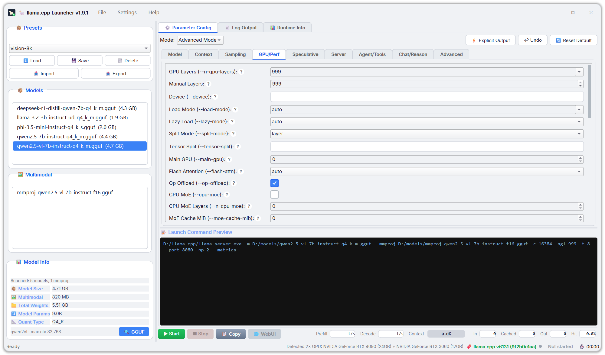
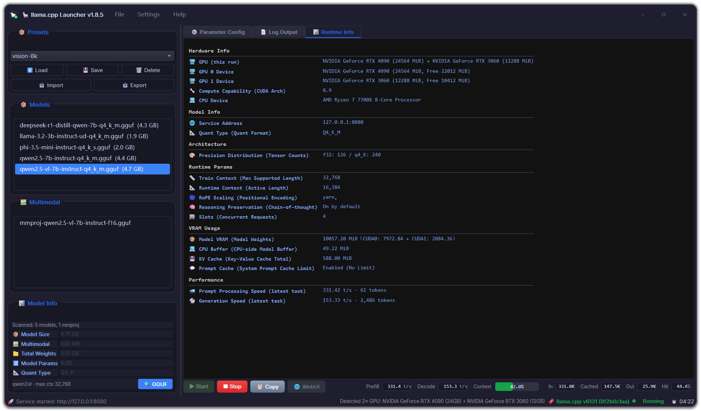

<div align="center">


# 🦙 Llama CPP Launcher

**A full-featured GUI for `llama-server` (llama.cpp) — bring your own binary.**

All CLI parameters configurable in the UI · live default detection · presets · real-time log parsing · live metrics · built-in GGUF inspector

[](https://github.com/Mars-Albert/llama-cpp-launcher/releases/latest)
[](https://www.python.org/)
[](https://pypi.org/project/PyQt6/)
[](LICENSE)
[-8a2be2)]()

**[⬇ Download Latest Release](https://github.com/Mars-Albert/llama-cpp-launcher/releases/latest)** · **[📖 中文文档](README_zh.md)**

</div>

---

<details>
<summary><b>📑 Table of Contents</b></summary>

- [Why this instead of a bundled-backend tool?](#why)
- [Screenshots](#screenshots)
- [Quick Start](#quick-start)
- [Features](#features)
  - [Two Modes](#two-modes)
  - [Advanced Mode — 9 Tabs](#advanced-tabs)
  - [Model Browser](#model-browser)
  - [Real-time Log Parsing](#log-parsing)
  - [Live Metrics Row](#metrics-row)
  - [Log Panel](#log-panel)
  - [Presets](#presets)
  - [Per-Parameter Help](#param-help)
  - [GGUF Inspector](#gguf-inspector)
  - [Server Lifecycle](#server-lifecycle)
  - [Window, Layout & Status Bar](#window-ui)
  - [Language & Theme](#i18n-themes)
- [Development](#development)
- [License](#license)

</details>

---

<a id="why"></a>

## 💡 Why this instead of a bundled-backend tool?

GUI tools that ship their own llama.cpp build are convenient — but the runtime is theirs, not yours. Llama CPP Launcher drives the `llama-server` binary **you** installed, and every flag it passes stays visible.

| | Llama CPP Launcher | Bundled-runtime tools |
|---|---|---|
| Upgrade llama.cpp | Swap the binary | Wait for an app update |
| Custom builds (CUDA / ROCm / Vulkan / Metal / SYCL) | Use any build you like | Whatever they bundled |
| A fix merged upstream today | Run it today | Wait for their release |
| Roll back a regression | Put the old binary back | Wait for them to fix it |
| The exact command being run | Always visible, one click to copy | Abstracted away |

It also stays in sync with whatever binary you point it at:

- **🔍 Live defaults** — runs `llama-server --help` on startup and uses your binary's *real* defaults, so nothing is hardcoded and stale. When a flag's default has drifted from the built-in table, a ⚠ appears in the status bar with the full list.
- **🗂️ Chat templates** — the ones your binary ships with show up automatically.
- **🖥️ Device probe** — `--list-devices` results land in the status bar (e.g. `Detected 2× GPU: RTX 5090 (32GB) + RTX 2080 (8GB)`). It only reports; it never auto-fills `--n-gpu-layers` for you.

No account, no telemetry, no bundled backend, nothing leaving your machine. One dependency: PyQt6.

<a id="screenshots"></a>

## 📸 Screenshots

<table>
  <tr>
    <td width="50%"></td>
    <td width="50%"></td>
  </tr>
  <tr>
    <td align="left"><sub>Advanced mode, light theme — 9 tabs, and the control row with live metrics below.</sub></td>
    <td align="left"><sub>Basic mode, dark theme, running — runtime info parsed live from the server log.</sub></td>
  </tr>
</table>

<sub>Images are rendered from the real UI with synthetic data: `python tools/render_screenshots.py`.</sub>

<a id="quick-start"></a>

## 🚀 Quick Start

**You need `llama-server`** — grab a build for your hardware from [ggml-org/llama.cpp releases](https://github.com/ggml-org/llama.cpp/releases) (or build your own). The launcher does not ship one.

### Option 1: Windows exe

1. Download `LlamaCppLauncher.exe` from [Releases](https://github.com/Mars-Albert/llama-cpp-launcher/releases/latest) — no Python required.
2. Point the app at your binary: **File → Set llama-server path…** (or leave it on `PATH` and it will be found automatically).
3. Pick a model, press **Start**, open the WebUI.

<sub>⚠️ Windows SmartScreen may warn about the unsigned exe — **More info → Run anyway**.</sub>

### Option 2: From source (any OS)

```bash
git clone https://github.com/Mars-Albert/llama-cpp-launcher.git
cd llama-cpp-launcher

python -m venv venv
venv\Scripts\activate   # Windows   ·   source venv/bin/activate  # Linux/macOS
pip install -r requirements.txt

python main.py          # or double-click run.bat on Windows
```

<a id="features"></a>

## ✨ Features

<a id="two-modes"></a>

### 🎭 Two Modes

| Basic mode | Advanced mode |
|---|---|
| Model & mmproj pickers, backed by the model browser | **All CLI parameters configurable in the UI**, grouped into 9 tabs |
| Sliders for temp / top-p / min-p / repeat penalty, top-k | LoRA adapters & scales, control vectors, image token limits |
| Context quick-picks 4K → 262K, GPU layers auto / all | Model sources: local file, HF repo, URL, Docker repo |
| ⚡ Quick toggles — **your choice** (Settings → Customize) | Speculative decoding, SSL/CORS, slots, embedding/rerank, MCP |

Switching modes never loses a value — both panels read and write the same parameter set, presets, undo history and command preview.

<a id="advanced-tabs"></a>

### 🎛️ Advanced Mode — 9 Tabs

| Tab | What's inside |
|---|---|
| 🧠 Model | Model file, alias, tags, HF/URL/Docker sources, LoRA, control vectors, mmproj |
| 📏 Context | Context size, prompt & KV cache, RoPE / YaRN scaling |
| 🎲 Sampling | Temperature, top-k/p, min-p, penalties, grammar, repetition |
| 🎮 GPU/Performance | Offload, memory, CPU threads, affinity, priority |
| ⚡ Speculative | Draft models (incl. draft-mtp), ngram, lookup cache |
| 🌐 Server | Host/port, slots, endpoints, SSL, CORS, embedding/rerank, router, Prometheus metrics |
| 🤖 Agent/Tools | Tool calling, MCP server, agent settings |
| 💬 Chat/Reasoning | Chat templates, reasoning mode, thinking budget |
| 🔧 Advanced | Text I/O, logging, `extra_args` escape hatch |

<a id="model-browser"></a>

### 📂 Model Browser

- 🔎 Background scan of your model directory — the UI never freezes (F5 to rescan, directory remembered)
- 🏷️ `.gguf` files sorted into **Models** / **Multimodal (mmproj)** with sizes; mmproj auto-matched by name
- 📏 Model info from the file header only (a few MB, cached, off the GUI thread): architecture, max context, size, estimated parameters, quant type — the row turns **amber** when your context exceeds the model's limit, because the server would clamp it at load

<a id="log-parsing"></a>

### 📊 Real-time Log Parsing

Every line of `llama-server` output is parsed as it arrives — 74 patterns covering both the classic and the current `srv`-prefixed formats — and distilled into the **Runtime Info** panel: 50+ read-outs across 8 groups (hardware, model, architecture, runtime params, VRAM, performance, system, vision).

It fills in **live**, not after the fact: offload layers while the model loads, buffer sizes during init, KV cache and graph splits as the context is built, and the state flips to ready the moment the server starts listening. Multi-GPU runs report per-device VRAM and buffer splits.

> 🔊 The launcher defaults `--log-verbosity` to **4 (trace)**: recent llama.cpp routes its own INFO lines to TRACE, so at the binary's default level there would be nothing to parse. If you lower it, the panel tells you why it looks empty.

<a id="metrics-row"></a>

### 📟 Live Metrics Row

The row below the tabs sits **outside** them, so it is visible on every tab:

| Group | Read-outs | Source |
|---|---|---|
| ⚡ Live (1 s) | Prefill t/s · Decode t/s · context gauge with the percentage inside it | `GET /slots` |
| 📈 Session (5 s) | Input tokens · cached · output tokens · cache hit rate | `GET /metrics` |

- Speeds are differenced locally and re-baselined at each task boundary, so a new request can never produce a negative t/s
- Session totals need the endpoint: **Advanced Mode → Server → “Prometheus Metrics (--metrics)”**, then restart the server. Before the first sample they read `0`; a value that genuinely cannot be read shows `—`. Each read-out's tooltip says which case you are in
- The layout never reflows — read-outs keep a fixed width and stay put while idle

<a id="log-panel"></a>

### 📄 Log Panel

- 🔍 **Ctrl+F** search with match count, wrap-around and level filter (D / I / W / E)
- 🪟 **A window per level** — each level keeps its own 5 000-line window, so a flood of hidden lines (a debug prompt dump, say) cannot evict the level you are filtering for
- 📤 Export the visible view or the **full run**; every run is also mirrored to `~/.llama-cpp-launcher/logs/last_run.log`
- Colorized by level, monospace, auto-scroll toggle, column alignment preserved

<a id="presets"></a>

### 💾 Presets

- Named presets store **only the diff against defaults**, so they stay small and portable; import/export as JSON
- Optionally exclude machine-local paths (model / mmproj) when saving — share a preset without your disk layout
- The preset you last loaded is restored on next start; parameter keys renamed or removed across llama.cpp versions are migrated on load

<a id="param-help"></a>

### ❓ Per-Parameter Help

Every row has a **?** button: the CLI flag, your binary's live default, the accepted range and a plain-language explanation — including what the negated form does (`--no-kv-offload` vs `--kv-offload`).

<a id="gguf-inspector"></a>

### 🔬 GGUF Inspector

A standalone inspector that reads the file header and metadata only — weights are never loaded, and the parser is pure stdlib:

- **7 tabs**: Overview · Statistics · Metadata · Tensors · Tokenizer · Filename · Diagnostics
- 📊 Quantization distribution, layer/module structure, parameter concentration
- 🩺 Launcher-aware diagnostics: context over the model's limit, mmproj mismatch, draft-mtp without its sidecar, chat-template / RoPE / MoE / shard notes
- 📤 Export to JSON / CSV / Markdown

<a id="server-lifecycle"></a>

### 🚀 Server Lifecycle

- ▶️ Start with a port-conflict check; graceful stop with a force-kill fallback, and the server is stopped when you close the app
- 🌐 One click to the llama-server WebUI, using your actual host/port
- 📝 **Command preview** — the exact command, rebuilt on every change, one click to copy (paths with spaces quoted correctly)
- ↩️ **Undo** — 800 ms-debounced snapshots, up to 20 steps

<a id="window-ui"></a>

### 🪟 Window, Layout & Status Bar

- 🗂 **Three full-height tabs** — Parameter config · Log output · Runtime info. On a 1080p window the log gets ~800 px instead of a 200 px strip, and the parameter / command-preview split is draggable
- 🎛 **One control row** — Start · Stop · Copy · WebUI plus the metrics row, outside the tabs so they work wherever you are
- 📌 **Status bar** — detected GPUs · binary version · ⚠ drift · state dot (idle / starting / running / error) · state text · runtime
- 🖼️ **Frameless rounded card** with a soft shadow, an integrated title row, and resize grips right at the visible card edge
- 🧘 **Small windows behave** — the parameter area never gets a vertical scrollbar and nothing gets squashed or overlapped: quick toggles re-wrap and the window's minimum grows instead
- 📐 First launch opens at 1600×940 with a 400 px model column; size, position, mode, tabs and splitters are restored next time

<a id="i18n-themes"></a>

### 🌐 Language & Theme

Chinese ↔ English and dark ↔ light switch live, with no restart, and the choice is remembered. Chinese is the source language, so an English string is an explicit translation entry — never a missing one.

<a id="development"></a>

## 🛠️ Development

```bash
pip install -r requirements.txt
pip install pytest
python -m pytest tests -q          # headless; the suite renders offscreen
```

Two things worth knowing before you touch anything:

- **`core/params_schema.py` is the single source of truth.** One entry per parameter drives the advanced UI, CLI emission, `get/set_values` and the i18n-coverage test — so adding a parameter is one entry, not five edits.
- **Qt-free where possible.** `gguf/`, `ui/log_parser.py`, `ui/command_builder.py`, `ui/live_stats.py` and `core/params_schema.py` have no Qt dependency, which is what makes the test suite headless.

**Releases**: pushing a `v*` tag runs CI — tests, then PyInstaller, then the exe is published as a GitHub Release. `build_config.py` and the tag are bumped together.

<a id="license"></a>

## 📄 License

[MIT](LICENSE)
