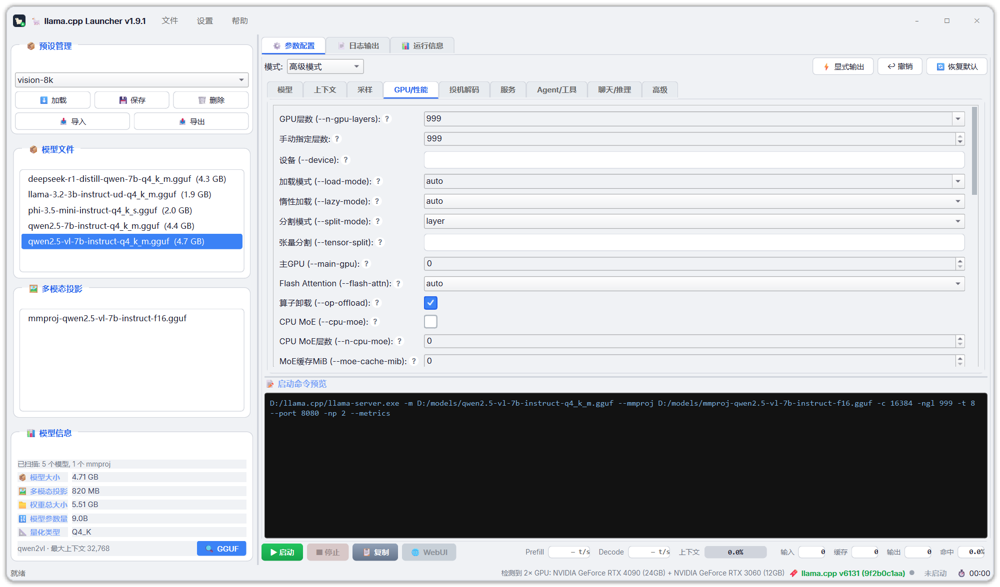
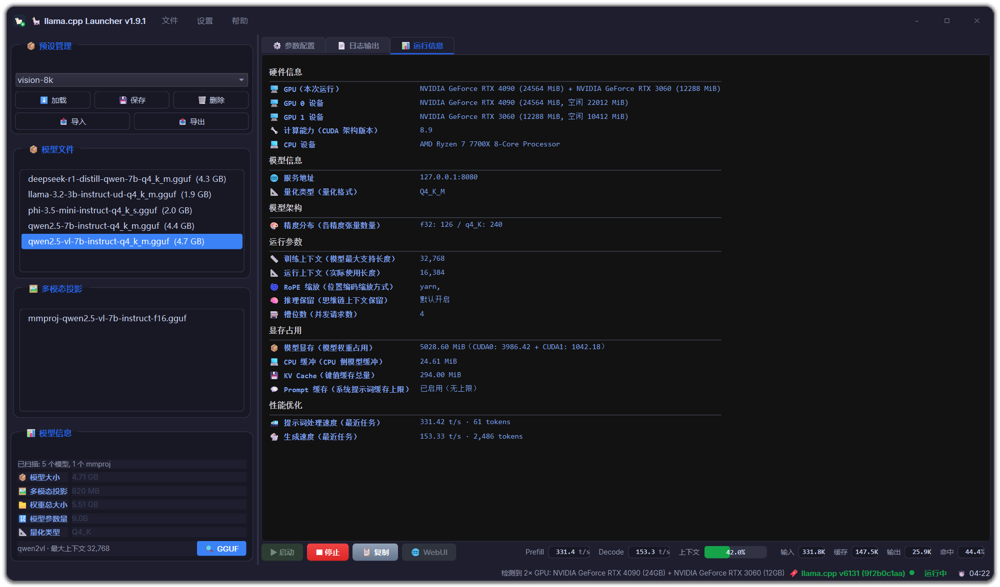

<div align="center">


# 🦙 Llama CPP Launcher / Llama 启动器

**`llama-server`（llama.cpp）的全功能图形界面，后端二进制你自己准备。**

**全部 CLI 参数可视化配置** · 动态默认值检测 · 预设管理 · 实时日志解析 · 实时指标带 · 内置 GGUF 检查器

[](https://github.com/Mars-Albert/llama-cpp-launcher/releases/latest)
[](https://www.python.org/)
[](https://pypi.org/project/PyQt6/)
[](LICENSE)
[-8a2be2)]()

**[⬇ 下载最新版本](https://github.com/Mars-Albert/llama-cpp-launcher/releases/latest)** · **[📖 English](README.md)**

</div>

---

<details>
<summary><b>📑 目录</b></summary>

- [为什么不用内置后端的工具？](#why)
- [软件截图](#screenshots)
- [快速开始](#quick-start)
- [功能详解](#features)
  - [双模式设计](#two-modes)
  - [高级模式 — 9 个标签页](#advanced-tabs)
  - [模型浏览器](#model-browser)
  - [实时日志解析](#log-parsing)
  - [实时指标带](#metrics-row)
  - [日志面板](#log-panel)
  - [预设管理](#presets)
  - [逐参数帮助](#param-help)
  - [GGUF 检查器](#gguf-inspector)
  - [服务生命周期](#server-lifecycle)
  - [窗口 · 布局 · 状态栏](#window-ui)
  - [语言与主题](#i18n-themes)
- [开发](#development)
- [许可证](#license)

</details>

---

<a id="why"></a>

## 💡 为什么不用内置后端的工具？

把 llama.cpp 打包进去的图形工具，能跑哪个版本、用哪套 backend 都由它的打包时刻死：想换 Vulkan/CUDA 构建、想直接用今天刚合进上游的修复、或者新版翻车了想退回上一版，都得等它重新发一版。本项目不打包，直接调用你机器上已有的 `llama-server`：界面上每一项都对应真实命令行开关，启动前能看到完整命令，也能原样复制出去。

| | Llama CPP Launcher | 打包内置后端的工具 |
|---|---|---|
| 升级 llama.cpp | 换个二进制文件 | 等它重新打包 |
| 自定义编译（CUDA / ROCm / Vulkan / Metal / SYCL） | 任意构建都能用 | 只能用内置那份 |
| 上游今天合入的修复 | 今天就用上 | 等它发版 |
| 新版翻车想退回 | 换回旧二进制文件 | 等它修完再发版 |
| 实际执行的命令 | 始终可见，一键复制 | 被抽象掉了 |

参数表和默认值也不是写死在程序里的：

- **🔍 动态默认值** — 启动时跑一次 `llama-server --help`，界面上的默认值取自你这个二进制，而不是仓库里抄的一份。两者对不上（多半是你的版本更新）时状态栏出现 ⚠，点开列出全部差异。
- **🗂️ 聊天模板** — 你的二进制内置的模板自动出现在界面里。
- **🖥️ 设备探测** — `--list-devices` 的输出显示在状态栏，例如 `检测到 2× GPU：RTX 5090 (32GB) + RTX 2080 (8GB)`。只显示，不会顺手替你写 `--n-gpu-layers`。

不需要账号，不联网，不上传任何数据；运行时依赖只有 PyQt6。

<a id="screenshots"></a>

## 📸 软件截图

<table>
  <tr>
    <td width="50%"></td>
    <td width="50%"></td>
  </tr>
  <tr>
    <td align="left"><sub>高级模式 · 浅色主题：9 个标签页，下方是常驻控制行与实时指标带。</sub></td>
    <td align="left"><sub>基础模式 · 深色主题，运行中：运行时信息从服务端日志实时解析。</sub></td>
  </tr>
</table>

<sub>截图由真实界面 + 合成数据渲染而成：`python tools/render_screenshots.py`。</sub>

<a id="quick-start"></a>

## 🚀 快速开始

**先准备好 `llama-server`**：从 [ggml-org/llama.cpp releases](https://github.com/ggml-org/llama.cpp/releases) 下载对应硬件的构建，或者自行编译。启动器不自带后端。

### 方式一：Windows exe

1. 从 [Releases](https://github.com/Mars-Albert/llama-cpp-launcher/releases/latest) 下载 `LlamaCppLauncher.exe`，无需安装 Python。
2. 指向你的二进制：**文件 → 设置 llama-server 路径…**（或者干脆把它放进 `PATH`，程序会自己找到）。
3. 选模型，点**启动**，打开 WebUI。

<sub>⚠️ exe 没有代码签名，Windows SmartScreen 可能会拦一次：点**更多信息 → 仍要运行**即可。</sub>

### 方式二：从源码运行（任意系统）

```bash
git clone https://github.com/Mars-Albert/llama-cpp-launcher.git
cd llama-cpp-launcher

python -m venv venv
venv\Scripts\activate   # Windows   ·   source venv/bin/activate  # Linux/macOS
pip install -r requirements.txt

python main.py          # Windows 下也可以双击 run.bat
```

<a id="features"></a>

## ✨ 功能详解

<a id="two-modes"></a>

### 🎭 双模式设计

| 基础模式 | 高级模式 |
|---|---|
| 模型 & mmproj 选择器（背后是模型浏览器） | **全部 CLI 参数可视化配置**，按职责分 9 个标签页 |
| 温度 / Top-P / Min-P / 重复惩罚滑块 + Top-K 数值框 | LoRA 适配器与缩放、控制向量、图像 Token 限制 |
| 上下文快捷按钮 4K → 262K，GPU 层数 auto / all | 模型来源：本地文件、HF 仓库、URL、Docker 仓库 |
| ⚡ 快捷开关，放哪几个自己定（设置 → 自定义快捷开关） | 投机解码、SSL/CORS、slots、embedding/rerank、MCP |

两种模式共用同一份参数，来回切换不丢值；预设、撤销记录和命令预览都以它为准。

<a id="advanced-tabs"></a>

### 🎛️ 高级模式 — 9 个标签页

| 标签页 | 里面有什么 |
|---|---|
| 🧠 模型 | 模型文件、别名、标签、HF/URL/Docker 来源、LoRA、控制向量、mmproj |
| 📏 上下文 | 上下文长度、提示词与 KV 缓存、RoPE / YaRN 缩放 |
| 🎲 采样 | 温度、top-k/p、min-p、各类惩罚、语法、重复惩罚 |
| 🎮 GPU/性能 | 卸载层数、显存、CPU 线程、亲和性、优先级 |
| ⚡ 投机解码 | 草稿模型（含 draft-mtp）、ngram、lookup cache |
| 🌐 服务 | host/port、slots、端点、SSL、CORS、embedding/rerank、router、Prometheus 指标 |
| 🤖 Agent/工具 | 工具调用、MCP 服务、agent 设置 |
| 💬 聊天-推理 | 聊天模板、推理模式、思考预算 |
| 🔧 高级 | 文本输入输出、日志、`extra_args` 兜底入口 |

<a id="model-browser"></a>

### 📂 模型浏览器

- 🔎 模型目录在后台线程扫描，界面不卡（F5 重扫，目录会被记住）
- 🏷️ `.gguf` 自动分为**模型** / **多模态（mmproj）**并显示体积；mmproj 按名称自动匹配
- 📏 只读文件头部（几 MB、带缓存、不在界面线程）：架构、最大上下文、体积、估算参数量、量化类型。上下文设得比模型上限高时这一行变**琥珀色**：服务端加载时按模型上限截断，设再大也没用

<a id="log-parsing"></a>

### 📊 实时日志解析

`llama-server` 的输出逐行到达、逐行解析：74 条模式同时覆盖旧格式和当前的 `srv` 前缀格式，汇总进**运行信息**面板，共 8 大类、50 余项数据（硬件、模型、架构、运行参数、显存、性能、系统配置、视觉编码器）。

面板内容随日志逐条补齐，不等任务结束：加载模型时补卸载层数，初始化时补缓冲大小，建上下文时补 KV 缓存与计算图切分，服务端开始监听的瞬间状态就切成就绪。多卡会分别列出每张卡的显存和缓冲占用。

> 🔊 启动器把 `--log-verbosity` 默认设为 **4（trace）**：新版 llama.cpp 把自己那些 INFO 行改走 TRACE，若沿用二进制默认级别，根本没有内容可解析。你要是把它调低了，面板会说明为什么看起来是空的。

<a id="metrics-row"></a>

### 📟 实时指标带

标签页**下方**那一行在标签页之外，因此任何标签页都常驻可见：

| 组 | 读数 | 来源 |
|---|---|---|
| ⚡ 实时（每秒） | Prefill t/s · Decode t/s · 上下文计量条（百分比写在条里） | `GET /slots` |
| 📈 累计（每 5 秒） | 输入 tokens · 缓存 · 输出 tokens · 缓存命中率 | `GET /metrics` |

- 速度差值在本地算，到任务边界就重新起算基线，新发起一个请求不会算出负速度
- 累计四项需要开启该端点：**高级模式 → 服务 → 「Prometheus指标 (--metrics)」**，然后重启服务。第一次采样之前读作 `0`；确实读不到的值显示 `—`。每一格的 tooltip 会说明当前是哪种情况
- 每个读数按最宽取值定宽，1 秒一次的刷新不会让整行左右跳；未运行时七项也留在原位，点「启动」不会重排

<a id="log-panel"></a>

### 📄 日志面板

- 🔍 **Ctrl+F** 搜索，带匹配计数与循环查找，另有级别过滤（调试 / 信息 / 警告 / 错误）
- 🪟 **每级独立窗口** — 每个级别各自保留 5 000 行，隐藏级别的日志爆发（比如 debug 提示词转储）不会把你正在看的级别挤掉
- 📤 可导出当前视图或**完整运行日志**；每次运行都会完整镜像到 `~/.llama-cpp-launcher/logs/last_run.log`
- 按级别着色、等宽字体、自动滚动开关，并保留 llama.cpp 用空格排出的列对齐

<a id="presets"></a>

### 💾 预设管理

- 命名预设**只存储与默认值的差异**，文件小而可移植；支持 JSON 导入 / 导出
- 保存时可以排除本机路径（model / mmproj），把预设发给别人不必连带自己的磁盘布局
- 上次加载的预设会在下次启动时自动恢复；跨 llama.cpp 版本被重命名或删除的参数键在加载时自动迁移

<a id="param-help"></a>

### ❓ 逐参数帮助

每个参数行都有 **?** 按钮：CLI 参数名、你这个二进制的实时默认值、取值范围和通俗解释，反向开关也一并讲清（`--no-kv-offload` 和 `--kv-offload` 各自做什么）。

<a id="gguf-inspector"></a>

### 🔬 GGUF 检查器

独立检查器，只读文件头部和元数据，从不加载权重；解析器是纯标准库写的：

- **7 个标签页**：概览 · 统计 · 元数据 · 张量 · 分词器 · 文件名 · 诊断
- 📊 量化分布、层/模块结构、参数集中度
- 🩺 启动器视角的诊断：上下文超出模型上限、mmproj 不匹配、draft-mtp 缺少 sidecar、聊天模板 / RoPE / MoE / 分片提示
- 📤 导出 JSON / CSV / Markdown

<a id="server-lifecycle"></a>

### 🚀 服务生命周期

- ▶️ 启动前做端口冲突检测；停止走优雅路径并以强杀兜底，关闭应用时自动停止服务
- 🌐 一键按你实际设置的 host/port 打开 llama-server WebUI
- 📝 **命令预览**：实际执行的命令随每次改动即时重建，一键复制，含空格的路径已正确加引号
- ↩️ **撤销**：800ms 防抖打快照，最多回退 20 步

<a id="window-ui"></a>

### 🪟 窗口 · 布局 · 状态栏

- 🗂 **三个整列高度的标签页**：参数配置 · 日志输出 · 运行信息。1080p 窗口下日志区约 800px 而不是 200px 的一条窄缝；参数区与命令预览之间可拖动分割
- 🎛 **一行控制按钮**：启动 · 停止 · 复制 · WebUI 与指标带都放在标签页外，切到哪个标签页都能用
- 📌 **状态栏**：检测到的显卡 · 二进制版本 · ⚠ 参数漂移 · 运行状态点（未启动 / 启动中 / 运行中 / 异常）· 状态文字 · 运行时长
- 🖼️ **无边框圆角卡片** 配柔和投影，一体式标题行，缩放热区正好落在可见卡片边缘
- 🧘 **窗口再小也不塌**：参数区永不出垂直滚动条，控件不会被压缩或重叠，快捷开关自动换行、窗口最小尺寸随之变大
- 📐 首次启动以 1600×940 打开，左侧模型栏 400px；窗口大小、位置、模式、标签页与分割栏位置下次自动恢复

<a id="i18n-themes"></a>

### 🌐 语言与主题

中英文、深浅色都是即时切换，不用重启，选择会记住。中文是源语言，每条英文文案都要单独登记，测试会扫出漏翻项，所以英文界面里不会夹出中文。

<a id="development"></a>

## 🛠️ 开发

```bash
pip install -r requirements.txt
pip install pytest
python -m pytest tests -q          # 无界面运行（测试用 offscreen 平台）
```

动手前值得知道的两件事：

- **`core/params_schema.py` 是唯一事实来源。** 一个参数只需一条记录，就同时驱动高级模式界面、CLI 命令生成、`get/set_values` 和 i18n 覆盖率测试，加一个参数只改一处。
- **能不碰 Qt 就不碰 Qt。** `gguf/`、`ui/log_parser.py`、`ui/command_builder.py`、`ui/live_stats.py`、`core/params_schema.py` 都不依赖 Qt，这正是测试能够完全无界面运行的原因。

**发布**：推送 `v*` 标签触发 CI，先跑测试，再 PyInstaller 打包，产物自动发布为 GitHub Release。`build_config.py` 与标签版本一起改。

<a id="license"></a>

## 📄 许可证

[MIT](LICENSE)
